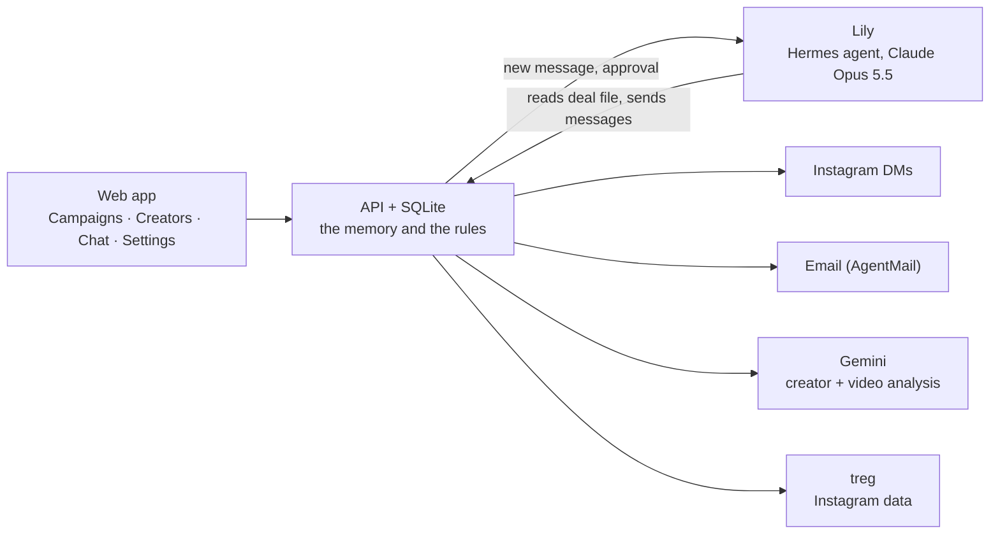

<p align="center"></p>

<p align="center"><b>Lily is an AI agent that runs a brand's creator campaigns from start to finish.</b><br/>
She finds creators, messages them, negotiates, reviews their videos and gives feedback.<br/>
You only step in for the few decisions that matter.</p>

<p align="center">Built in 90 minutes at <b>Product Unconference 2026</b>.</p>

---

## For judges: where to look

| Criterion | Short answer | Section |
|---|---|---|
| **It works** | Real Instagram DMs, real email, real video review. Status table below | [It works](#1-it-works) |
| **Problem and user** | A $32.5B market still run by hand, mostly by one-person teams | [Problem and user](#2-problem-and-user) |
| **Product sense and feasibility** | 3 inputs to start, 4 approval moments, rules enforced in code, about 1 cent to analyse a creator | [Product sense](#3-product-sense-and-feasibility) |
| **Use of AI** | One agent with memory per deal, plus vision models that read creators' videos | [Use of AI](#4-use-of-ai) |
| **Demo** | A creator "forgets" the event ID card; Lily catches it and asks for a redo | [Demo](#5-demo) |

---

## 1. It works

What runs today, all live, on one laptop:

| Step | What happens | Status |
|---|---|---|
| Start | Budget + product link + goal → Lily reads the page and proposes 3 campaign ideas | 🟡 building |
| Find | Searches Instagram reels by keyword, analyses each creator's last 10 reels | 🟡 building |
| Ask | Follows and DMs creators on Instagram, emails them from `lily@email.makelocalads.com` | 🟡 building |
| Agree | Negotiates inside the brand's limits, escalates to you when a creator asks for more | 🟡 building |
| Make | Watches the creator's video and checks every rule ("ID card visible?") | 🟡 building |
| Approve | You approve the shortlist, the deal, the final video and the payment | 🟡 building |
| Track and pay | Performance every 6 hours, payouts | Screens only (shown with sample data) |

> This table is updated when the build finishes. Run it yourself: [Run locally](#run-locally).

---

## 2. Problem and user

**The user:** a marketing manager at a small brand who wants creators to make videos about their product.

**The problem in numbers:**

| Fact | Number | Source |
|---|---|---|
| Size of influencer marketing | **$32.55B** in 2025 | [Influencer Marketing Hub, via FirstPromoter](https://firstpromoter.com/blog/influencer-marketing-statistics) |
| Brands planning to spend more in 2026 | **87.5%** | same |
| Brands with no dedicated influencer marketer | **53%** (81 e-commerce brands) | [Modash](https://www.modash.io/blog/influencer-marketing-statistics) |
| Marketers who say finding creators is getting harder | **87.5%** | Modash |
| Marketers who run out of good creators mid-campaign | **96.4%** (at least some campaigns) | Modash |
| Unpaid overtime influencer marketers work | **2.9 hours a week** | Modash |
| Agencies that run this for you | **$3,000–$15,000 a month** | [Darkroom](https://www.darkroomagency.com/observatory/social-media-marketing-services-2026) |
| Creators who have been paid late or missed a payment | **87%** of 750 creators | [Business Insider, 2022](https://www.businessinsider.com/data-survey-creators-have-been-paid-late-or-missing-payments-2022-7) |

**What the work looks like without Lily:** for every creator, someone has to find them, check whether they're any good, write a DM, follow up, agree on a price, write a contract, chase the video, watch it, write feedback, check the revision and pay. Multiply that by 10–50 creators per campaign. Most brands don't have one person whose job is this.

---

## 3. Product sense and feasibility

**One screen to start.** Budget, product link, goal. Lily works out the brand, logo and product from the link herself; you can correct them in Settings.

**You choose how much Lily does on her own:**

| Mode | You approve |
|---|---|
| Human-first | The shortlist, each deal, each final video, each payment |
| Autopilot | Payments only |
| Full autopilot | Nothing (coming soon) |

**Rules live in code, not in the prompt.** Lily can't offer more than the brand's limit. The server rejects it, and she has to ask you. Limits come from your budget: max fee per creator = budget ÷ creators × 1.2.

**Actions, not dashboards.** Every screen answers two questions: *what is Lily doing* and *what does she need from me*. There are no charts to read.

**Cheap enough to run on every creator** (estimates):

| Work | Cost |
|---|---|
| Analyse one creator (profile + 10 reels + one AI read) | ~**$0.01** |
| Search reels for one keyword | $0.0015 |
| An agency to do the same | $3,000–$15,000 a month |

**Feasible today.** It runs on one laptop: a small API with a SQLite database, an agent, and a web app. The channels are real: Instagram DMs and email.

**Honest limits.** Instagram DMs go through a personal account (fine for a demo, but needs Meta's official messaging API to scale). Payments and the 6-hour performance tracking are screens with sample data, not live yet.

---

## 4. Use of AI

| Where | Model | What it does |
|---|---|---|
| **Lily, the agent** | Claude Opus 5.5 on [Hermes Agent](https://github.com/NousResearch/hermes-agent) | Plans the campaign, writes every message, negotiates, decides the next step |
| **Reading the product page** | Gemini | Pulls out brand, logo, product and price from any link |
| **Judging creators** | Gemini (vision) | Looks at a creator's last 10 reels: do they show products clearly, is it on brand, is it safe |
| **Reviewing videos** | Gemini (video) | Watches the submitted video and checks each rule with a timestamp ("ID card first visible at 0:06") |

**What makes it work:**
- **Memory per deal.** Every creator gets one file holding the brief, the limits, every message on Instagram and email, every offer and every video round. Lily reads it before each reply. She never mixes up creators and never leaks one creator's price to another.
- **Structured output.** Lily never puts ideas or deals in free text for the app to parse. She saves them through the API, and the app shows them as cards with buttons.
- **AI where it adds judgement, code where it must be exact.** Prices, limits and stage changes are checked by code. Tone, negotiation and feedback are done by the AI.

---

## 5. Demo

The event *is* the product: we promote **Product Unconference 2026**.

1. **Start.** $1,500 · `theproductfolks.com/product-unconference-2026` · goal: *"Get PMs to sign up. The Unconference ID card must be clearly visible in every video."*
2. **Ideas.** Lily reads the page and proposes 3 campaign ideas, each with the ID-card rule. We pick one.
3. **Find.** Creators appear on the campaign page, each with the reason Lily picked them.
4. **Outreach.** We add a creator by hand, Ansh. Lily DMs him on Instagram within seconds.
5. **Negotiate.** Ansh asks for more than the limit. Lily counters, then asks us. We approve the deal.
6. **The catch.** Ansh sends his video **without the ID card**. Lily spots it, praises what works and asks for one fix.
7. **Done.** Round 2 shows the card. We approve the video, and the payment appears ready to approve.

🎥 Demo video: *coming after the hackathon*

---

## How it's built



| Folder | What's inside |
|---|---|
| `api/` | Bun + Hono + SQLite. Campaigns, deals, offers, approvals, creator search, channels, video review |
| `hermes/` | Lily: her persona, one skill per campaign step, webhook routes |
| `web/` | The admin app (React + Halaska UI kit) |
| `db/` | Database schema |
| `PLAN.md`, `CONTRACT.md` | The build plan and the interfaces every part was built against |

**How we built it in 90 minutes:** one orchestrator agent wrote the plan and the interfaces, then 6 AI coding agents built the API, creator search, channels, video review, Lily and the web app in parallel. Each owned one folder, and the shared contract kept them in sync. The plans are in `plans/`.

## Run locally

```bash
cp .env.example .env              # add your keys
cd api && bun install && bun run seed && bun run dev    # API on :4400
cd hermes && ./install.sh                               # Lily on Hermes
cd web && bun install && bun run dev                    # app on :5180
```
