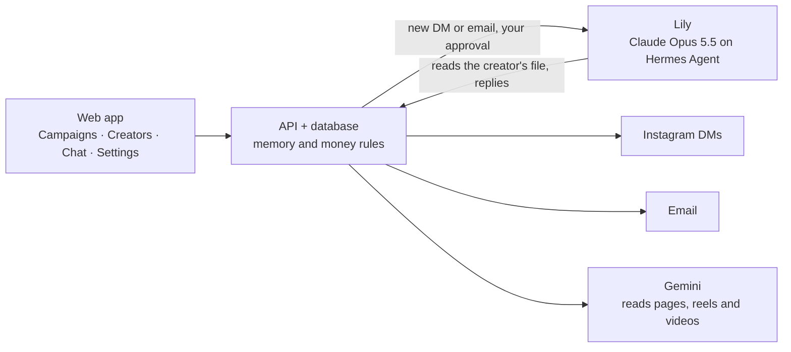

<p align="center"></p>

<p align="center"><b>Lily runs your creator campaigns for you.</b><br/>
Give her a budget, a product link and a goal. She finds creators, messages them, agrees on a price,<br/>
reviews their videos and asks you only when a decision is really yours.</p>

---

## Creator marketing is big, and still done by hand

- Brands spent **$32.55B** on influencer marketing in 2025, and **87.5%** plan to spend more in 2026. ([Influencer Marketing Hub](https://firstpromoter.com/blog/influencer-marketing-statistics))
- **53%** of e-commerce brands have no one whose job is influencer marketing. It lands on a marketer who already has a full job. ([Modash](https://www.modash.io/blog/influencer-marketing-statistics))
- **87.5%** of influencer marketers say finding creators is getting harder, and **96%** run out of good creators in at least some campaigns. (Modash)
- The people who do this job work **2.9 hours of unpaid overtime a week**. (Modash)
- Handing it to an agency costs **$3,000–$15,000 a month**. ([Darkroom](https://www.darkroomagency.com/observatory/social-media-marketing-services-2026))
- On the other side, **87%** of creators have been paid late or not at all. ([Business Insider](https://www.businessinsider.com/data-survey-creators-have-been-paid-late-or-missing-payments-2022-7))

For every creator, someone has to find them, check they're good, write a DM, follow up, agree on a price, chase the video, watch it, write feedback, check the redo and pay. Then do it again for the next 20 creators.

## What Lily does

| | Lily | You |
|---|---|---|
| **Start** | Reads your product link, works out the brand, logo and product, and proposes 3 campaign ideas | Type budget, link and goal. Pick an idea |
| **Find** | Searches Instagram reels, studies each creator's last 10 videos, shortlists the best with reasons | Approve the shortlist |
| **Reach out** | Follows and DMs creators on Instagram, emails them from her own inbox | — |
| **Agree** | Negotiates inside your limits and asks you if a creator wants more | Approve the deal |
| **Make** | Watches each video, checks every rule you set, gives warm and specific feedback until it's right | Approve the final video |
| **Pay** | Prepares the payment from the agreed terms | Approve the payment |
| **Next time** | Checks creators you've worked with before first | — |

You talk to her in a chat, like you would to a teammate: *"How's the launch going?"*, *"Offer @mia $50 more"*, *"Add @ansh to this campaign."*

## Built so you can trust it

**You decide how much she does alone.** *Human-first:* you approve the shortlist, every deal, every final video and every payment. *Autopilot:* you approve payments only. *Full autopilot* is next.

**Money rules live in code, not in a prompt.** Lily's maximum offer comes from your budget (budget ÷ creators × 1.2). If she tries to go above it, the server refuses, and she has to come and ask you. No clever message from a creator can talk her past it.

**Every creator has one file, and Lily reads it before she replies.** It holds the brief, your limits, every Instagram and email message, every offer and every video round. That's why she remembers a conversation from three days ago across two channels, and why she never mixes up creators or leaks one creator's price to another.

**The screens show actions, not charts.** Each page answers two questions: *what is Lily doing* and *what does she need from me*. A creator's row says "Countered at $220, waiting for her reply", not a score.

## How it works



| Job | AI | Example |
|---|---|---|
| Talking, negotiating, deciding the next step | **Claude Opus 5.5**, running as an agent on [Hermes](https://github.com/NousResearch/hermes-agent) with one skill per campaign step | Ansh asked for $450 against a $360 limit; Lily countered at $340 and he took it |
| Understanding the product | **Gemini** reads the product page | "Brand: The Product Folks. Product: Product Unconference 2026" |
| Judging a creator | **Gemini** looks at their last 10 reels | "Shows products up close, posts 4× a week, face on camera" |
| Reviewing a video | **Gemini** watches it and checks each rule with a timestamp | "No ID card shown" in round 1; "ID pass held up clearly at 0:11" in round 2 |

Lily never writes ideas, offers or approvals as free text for the app to guess at. She saves them through the API, and the app shows them as cards with buttons. The AI handles judgement and tone; code handles prices, limits and stages.

## What it costs to run

| Work | Cost |
|---|---|
| Search reels for a keyword | $0.0015 |
| Analyse one creator (profile, 10 reels, one AI read) | about $0.01 |
| Everything runs on | one laptop: an API with SQLite, the agent and a web app |

## See it in action

The demo promotes the event this was built at: **[Product Unconference 2026](https://www.theproductfolks.com/product-unconference-2026)**.

1. **Start.** $1,500, the event link, and the goal *"Get PMs to sign up. The Unconference ID card must be clearly visible in every video."*
2. **Ideas.** Lily reads the page and proposes 3 ideas. Each one carries the ID-card rule word for word.
3. **Creators.** The campaign fills up with creators and the reason she picked each.
4. **Outreach.** We add Ansh by hand. Lily DMs him on Instagram within seconds.
5. **Negotiation.** Ansh asks for $450, above Lily's $360 limit. She counters at $340, he accepts, and the deal waits for our OK. We approve.
6. **The catch.** Ansh sends a video **without the ID card**. Lily notices, says what she liked, and asks for one fix.
7. **Done.** The second video shows the card. We approve it, and the payment is ready to approve.

🎥 **[Watch the full run (2:47)](demo/lily-demo-2m47s.mp4)**, recorded live: one chat message → campaign → negotiation with a real creator → video sent back for the missing ID card → approved → payment waiting. Waits are sped up.

## Where it stands

| | |
|---|---|
| ✅ Live | Instagram DMs, email, creator search and analysis, negotiation with limits, video review, approvals, chat with Lily |
| 🖼️ Screens with sample data | Post-launch performance (checked every 6 hours), payouts |
| 🔜 Next | Full autopilot, Meta's official messaging API instead of a personal account, real payouts |

## Run it

```bash
cp .env.example .env                                     # add your keys
cd api && bun install && bun run seed && bun run dev     # API on :4400
cd hermes && ./install.sh                                # starts Lily
cd web && bun install && bun run dev                     # app on :5180
```

`api/` is the API and database. `hermes/` holds Lily's persona and skills. `web/` is the app. `PLAN.md` and `CONTRACT.md` are the plan and the interfaces each part was built against.

<sub>Built in 90 minutes at Product Unconference 2026. One agent wrote the plan; six AI coding agents built the API, creator search, channels, video review, Lily and the app in parallel. Their plans are in <code>plans/</code>.</sub>
